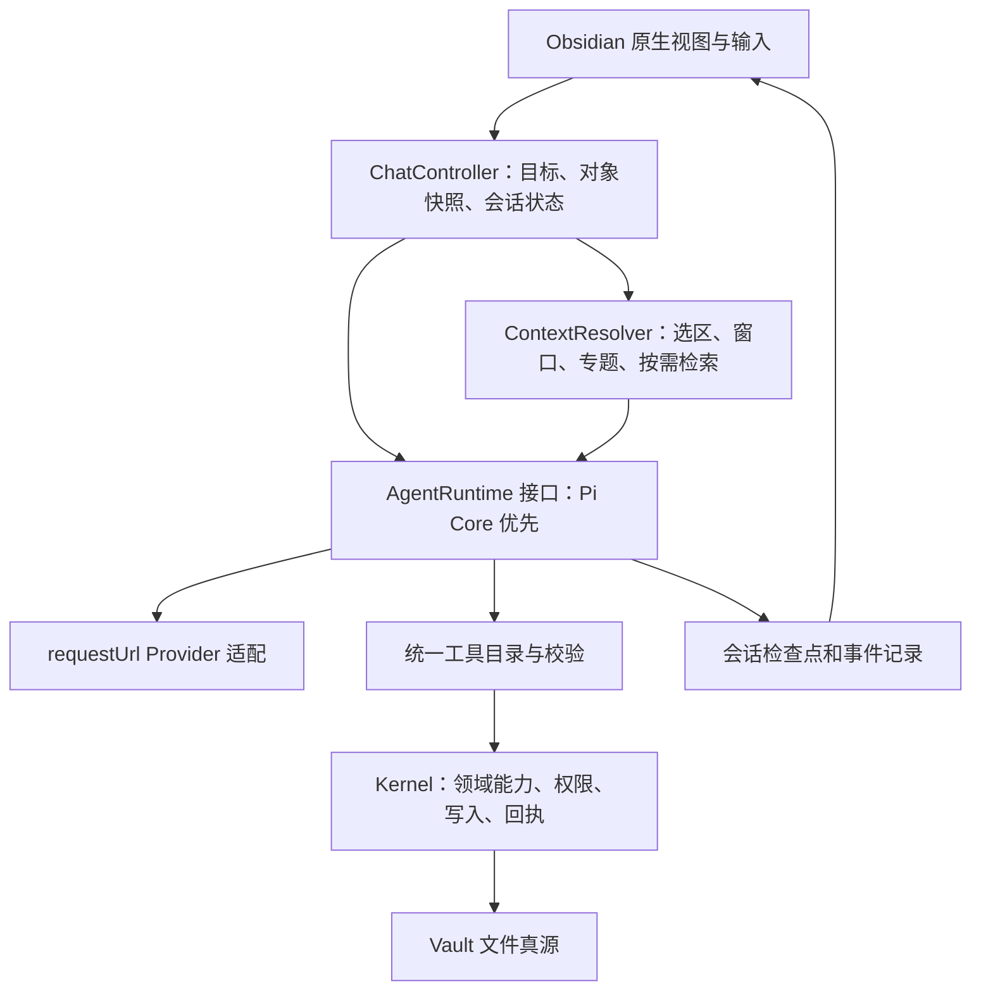
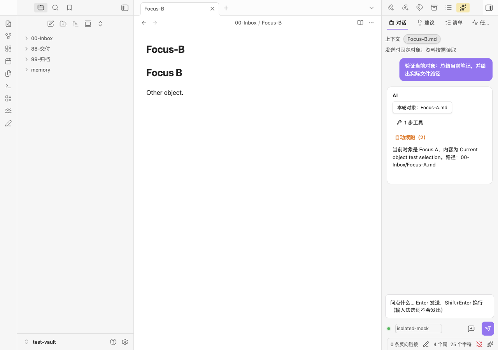
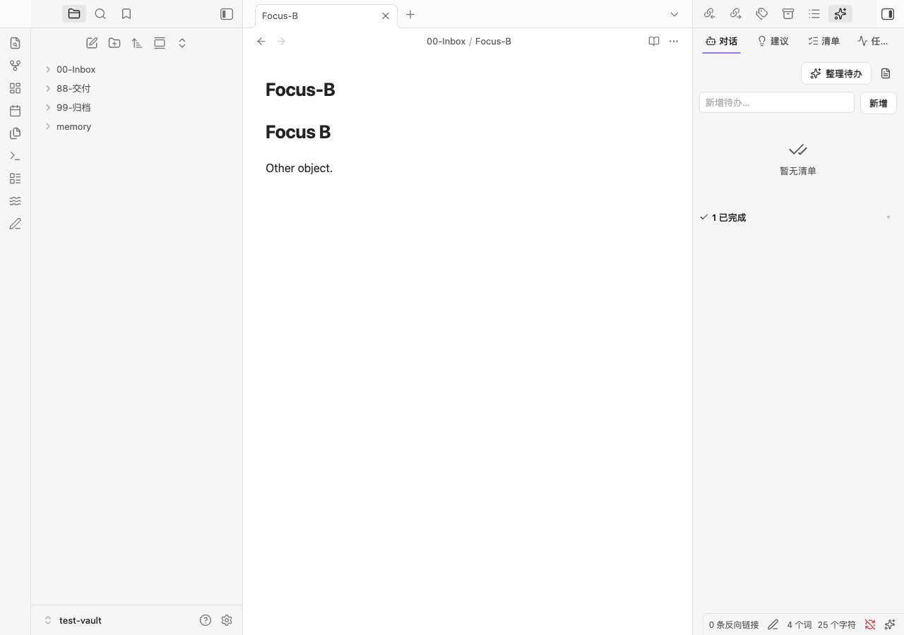

# Obsidian 插件全面审查与 4.19.0 升级记录

> 本文记录 4.19.0 审查时的状态。后续共享契约、会话重构与缺口更新见 [4.20.0 整改记录](OBSIDIAN-REFACTOR-2026-10-25.md)；当前实现以 ARCHITECTURE.md 为准。


审查时间：2026-10-24 至 2026-10-25。范围：产品边界、UI/UX、上下文、聊天智能体、待办、AI 建议、记忆、技能、模型适配、文件操作、架构与验证。关联的三端总体审查见主仓库 `docs/ARCHITECTURE-AUDIT-2026-10-24.md`。

## 判断

方向值得保留：Obsidian 原生编辑器和文件是主体，插件负责动态捕获、检索、行动和沉淀。问题集中在能力之间的连接、状态真实性和重复实现；继续添加面板、流程和提示词并不能解决这些问题。

现有聊天确实会连续读取、搜索、编辑和执行工具，并非纯问答包装。但它仍把历史与工具结果压平成文本，再解析模型输出的 JSON 指令；缺少原生工具协议、可靠的会话检查点和统一运行时，不能据此宣称已经具备完整、可恢复的通用智能体能力。

**建议以 Pi Core 为下一阶段的优先运行时方案，保留 Kernel 作为领域能力和写入权限的唯一执行边界。4.19.0 已修复本报告所列的生产缺陷，尚未切换生产运行时。** 完整 Pi Coding SDK、直接重写成另一套编辑器、大规模工作流编排平台，均不适合作为本轮默认方案。

## 能力审查与已落地修复

| 领域 | 发现的实际问题 | 4.19.0 行为与证据 |
|---|---|---|
| 当前对象 | 对话没有绑定笔记、选区或动态页；侧栏获得焦点后容易丢失原编辑对象 | 从最近主叶面捕获对象，发送时固定路径、选区和行号；动态视图返回实际选中周期路径；重试、恢复沿用原对象 |
| 上下文 | 预读全局资料与 UI 声称的“已知上下文”不一致 | 请求相关资料按需预读；当前文件有行号窗口、内容哈希、最近专题首页；单条回复显示本轮对象，顶部显示当前打开对象 |
| 编辑安全 | 编辑器未保存内容可能被磁盘工具覆盖 | 发送时检测缓冲区差异，阻止对该对象的写入，提示保存；当前对象上下文拒绝库外符号链接 |
| 侧栏打开 | 新建侧栏叶面后未 reveal，折叠面板可能始终不可见 | 新建和复用叶面均显式 reveal，真实 Obsidian 已验证 |
| 聊天状态 | 运行中可清空会话；历史回复可错误地用后续历史重生成；关闭后仍更新界面 | 工作时禁用新会话，清空同时清理目标；只重试最后回复；关闭触发暂停并停止界面回写 |
| 工具执行 | 白名单中存在未实现分支 | 补齐 `update_todo`、`set_todo_due`、`delete_todo`、`append_stream_entry`、近期动态/记忆发现、待审写入发现 |
| 待办语义 | 仅已完成项目时清理入口消失；来源路径忽略年份目录；错误被吞掉 | 完成区独立展示；使用真实周期索引跳转；增删改均返回写入结果；直接新增支持中文输入法；修改文字保留截止日 |
| 待办检索 | 读取清单会创建文件；模糊切换可能命中错误项目 | 读取不创建清单；多个文本命中必须用明确 ID |
| AI 建议 | 失败返回旧卡片而不报错；多个表面可重复生成；按钮失败后永久禁用 | 服务层合并并发请求；失败可见，保留缓存与刷新入口；按钮始终恢复；模型配置变化使旧请求结果失效 |
| 记忆闭环 | 告诉模型“去建议中确认”，却没有实际卡片 | 新增 `propose_memory_change`，支持新增、更新、归档画像事实；生成真实建议卡片，确认后复用 Kernel apply；未确认时目标为等待确认，不算完成 |
| 技能 | 提供发现和加载接口，但独立发行包缺少技能资源和共享规约读取 | 嵌入 8 个技能、23 份 Markdown 资源；`load_skill_resource` 解析同技能参考和共享文档；正文不自动塞入上下文 |
| 模型配置 | 只改变默认模型或模型选项，缓存 Provider 可能继续使用旧配置 | 完整 AI 配置参与失效判断；不记录配置哈希内容 |
| 请求处理 | abort 轮询泄漏；裸 `.finally()` 可能产生未处理拒绝；Anthropic 丢弃前面的文本块 | 请求结束统一清理计时器；所有文本块拼接；错误中回显的凭证做脱敏 |
| 后台任务 | `{ok:false}` 被标为完成；旧任务结束会释放新一代队列 | 正确标为失败；队列代际隔离，迟到结果不能扰乱新队列 |
| 文件移动 | 复制目标失败后仍可能删除源文件；移动实现重复 | 移动复用改名路径；核验目标内容和源文件未变后才移除源；失败测试确认原文保留 |
| 文件边界 | 新文件的父目录可通过链接越界；部分写工具可绕过记忆围栏 | 检查目标与父目录的真实边界；围栏覆盖别名、移动目标、专题创建和动态追加 |
| 交付快照 | 发布可覆盖同名既有交付文件；目录解析重复 | 使用工作区角色解析交付目录；同名文件拒绝覆盖 |

主要实现位置：[`editor-context.ts`](../src/services/editor-context.ts)、[`kernel-service.ts`](../src/services/kernel-service.ts)、[`kernel-workspace-ops.ts`](../src/services/kernel-workspace-ops.ts)、[`workspace-agent-tools.ts`](../src/services/workspace-agent-tools.ts)、[`sidebar-dock-view.ts`](../src/views/sidebar-dock-view.ts)、[`skill-resources.ts`](../src/services/skill-resources.ts)。

## 应精简、保留和加强的设计

**应精简：**

- 将“发现工具、JSON 示例、参数格式、权限说明”逐步收敛为一份机器可读工具目录，自动生成模型 schema 与展示信息，消除白名单和 dispatcher 漂移。
- 聊天直接行动、建议审阅、后台任务共用运行状态和结果结构，减少每个视图各自维护请求、错误、缓存与取消语义。
- 取消“永久不得用 Pi”一类实现层规约和相应依赖禁用断言。本轮已移除包级框架禁用测试，改为保留 UI 不直接耦合运行时的边界。
- 普通查询不创建笔记、清单或台账；明确授权的内容编辑不重复索要同一层授权；无需每次预加载全部技能、画像、动态和复盘。
- 不再通过增加多套模态框、固定收尾模板和自动续跑次数来代替正确的目标、工具结果与完成条件。
- 原生文件树、编辑器、链接导航继续交给 Obsidian；无需迁移成 React 编辑器或引入新的工作区数据库。

**应保留：**

- 文件真源、Kernel 写入围栏、路径验证、可恢复操作、实际回执，以及错误不能冒充成功。
- 技能的渐进披露、可选连接器、无 AI 时基本捕获和浏览仍可用。
- 内容编辑、文件生命周期、长期记忆建议之间的权限差异。模型更强并不会自动提供文件事务或正确的用户授权。

**应加强：**

- 本轮目标 + 对象快照 + 实际证据 + 原生工具结果，组成明确的 turn 数据结构；提示词负责意图，程序负责边界。
- “建议”展示具体目标与差异、证据来源和冲突信息；“已生成建议”“等待确认”“已实际写入”保持三个不同状态。
- 对用户明确提出的记忆更新，后续提供受约束的正式记忆工具及授权传递；模型自行提出的长期记忆变更保留审阅。本版仍使用确认卡片。
- 待办需要可追溯来源、截止日修改、歧义拒绝与删除后不重复提取；优先复用已有 Kernel，避免第二套待办数据库。
- 大库先用检索命中和任务完成评测判断瓶颈；有证据再加入混合检索或向量索引，不将向量数据库当作默认前提。

## Pi 与其他架构方案

### 已验证事实

官方变更记录和 npm 在审查时均给出 Pi **1.4.0**；`pi-agent-core` 声明 Node `>=22.19.0`。SDK 的 `createAgentSession` 是更高层的 coding session，会涉及认证、资源发现、会话存储等默认集成；适配插件时必须明确关闭或替换不需要的部分。[Pi changelog](https://pi.dev/changelog)、[SDK 文档](https://pi.dev/docs/latest/sdk)、[Agent Core 源码和包声明](https://github.com/earendil-works/pi/tree/main/packages/agent)。

隔离实验固定安装 1.4.0，没有更改插件生产依赖：

- 注入模拟 `streamFn`，完成 `system → user → assistant(toolCall) → toolResult → assistant`。
- `beforeToolCall` 阻止写入，模型收到错误工具结果并继续：2 次模型请求、0 次实际写入。
- 仅导出 `Agent` 的 esbuild 最小化 ESM 包为 **168,656 bytes**；`platform:node` 与 `platform:browser` 都成功，没有外置 Node 内置模块。709 个输入模块是构建读取数，不是插件运行时启动了 709 个功能。
- 同一工具拦截实验的浏览器包在实际 Obsidian 渲染进程运行成功；宿主运行时 Node 22.22.1、Electron 39.8.3。
- 这证明 Core 与宿主的基本兼容性，**没有证明所有真实服务商、长会话和流式网络传输都已适配**。

可复现实验：

```sh
npm install --prefix /private/tmp/topmind-pi-probe --ignore-scripts --no-audit --no-fund --package-lock=false @earendil-works/pi-agent-core@1.4.0 @earendil-works/pi-ai@1.4.0
cp scripts/probe-pi.mjs /private/tmp/topmind-pi-probe/probe.mjs
node /private/tmp/topmind-pi-probe/probe.mjs
```

### 方案比较与决策

| 方案 | 适合之处 | 成本与边界 | 判断 |
|---|---|---|---|
| 继续增强当前自研循环 | 迁移少，现有工具与目标协议可直接用 | 多协议、schema、压缩、取消、恢复继续自行维护；三端实现容易漂移 | 短期兼容层，避免继续堆大 |
| **Pi Agent Core** | 原生消息与工具循环、事件、工具拦截、steer/follow-up；可注入传输 | 仍需 Obsidian `requestUrl` 适配、工具 schema、会话存储和 Kernel 权限；已完成宿主基础实验 | **下一阶段首选** |
| Pi Coding SDK | 完整 coding session、扩展与资源系统 | 默认能力范围大于知识库副驾；要禁用默认 shell/文件工具、认证与全局资源扫描，并避免双份会话和技能发现 | 有明确 coding 产品需求再考虑 |
| AI SDK ToolLoopAgent | 官方提供工具循环、停止条件和生命周期配置；可与 Desktop 的 Provider 层衔接 | 仍需宿主传输与持久化适配；本轮仅查阅文档，没有完成等价打包和实机实验 | 候选方案，不给出未经测量的成本优势 |

[AI SDK ToolLoopAgent 官方文档](https://ai-sdk.dev/docs/reference/ai-sdk-core/tool-loop-agent)。Pi 的 cwd/project trust 不构成操作系统沙箱，换框架之后 Kernel 围栏仍必须保留。[Pi 安全文档](https://pi.dev/docs/latest/security)。

### 推荐的最终边界



这是目标架构，当前代码尚未完成这一拆分。当前 `sidebar-dock-view.ts` 约 2,000 行、`kernel-workspace-ops.ts` 约 1,900 行、`kernel-service.ts` 约 1,200 行；`styles.css` 也有多轮叠加的选择器。应围绕上述职责拆分、合并重复样式，避免同时引入新的前端框架和多个智能体编排层。

## 尚未完成的升级与验收条件

| 优先级 | 后续升级 | 完成标准 |
|---|---|---|
| P1 | 原生工具协议与共享运行时 | OpenAI-compatible、Anthropic、Google 的真实工具消息与结果可回放；工具 schema 和执行分支来自同一目录；保留不支持原生 tools 的网关兼容路径 |
| P1 | 会话恢复 | 用明确版本的会话记录持久化对象、目标、检查点和工具证据；暂停、关闭、崩溃后可恢复；避免重复执行已完成写入 |
| P1 | 取消的实际边界 | 后台队列目前是停止跟踪，不能取消 `requestUrl` socket，也不能保证已经进入 Kernel 的操作停止；需要将协作取消检查接到模型返回与后续写入边界，避免只改变 UI 状态 |
| P1 | 编辑器并发 | 当前未保存检测是发送时快照；模型运行期间新产生的未保存编辑、其他已打开编辑器和整文件覆盖，需要执行前重新核验与冲突处理 |
| P1 | 建议持久化与冲突预览 | 本版聊天记忆提案保存在会话内，重载可能丢失；应统一持久化待确认提案，执行前对比原文/版本，逐项展示结果 |
| P1 | 统一移动事务 | 本版已阻止失败后删除源文；复制与移除仍不是原子事务，崩溃可留下两份文件。需要共享 Kernel 的可恢复移动事务与恢复记录 |
| P2 | UI 与样式整合 | 对话控制器、待办面板、建议面板分离；整理重复样式；覆盖深色主题、320px 侧栏、键盘焦点和读屏 |
| P2 | 模型与检索质量评测 | 本轮是确定性模拟模型，不能代替真实模型质量评估；固定对象指代、选区改写、跨文件检索、长任务、待办歧义、记忆冲突等用例，统计命中率、错写数、完成率、延迟和成本 |

迁移首先以相同用例通过当前实现与 Pi Core 适配器的对照测试，再切换默认；禁止在工具消息尚未真实打通时，把文本 JSON 套进 Pi 并宣称原生 Agent 已完成。

## 验证与使用范围

本轮共 **216 项自动测试通过**，含新增的 33 项执行行为回归；`typecheck`、`lint`、生产构建均通过。新增测试直接调用发行的 TS 模块与真实 Kernel，在临时文件系统中检查结果，并使用原生视图 DOM stub 覆盖关键交互。

真实 Obsidian + 独立临时用户目录 + 临时 Vault + 本地模拟 AI 服务已验证：

1. 实际加载 4.19.0，解析真实的相对 `manifest.dir`。
2. 打开折叠的右侧面板，选中 A 笔记的 14 字文本。
3. 发送后立即切到 B；工具默认读取 A，最终记录和“本轮对象”仍为 A。
4. 新增中文待办并完成；无未完成项时，清理已完成入口仍可见。
5. Pi Core 浏览器包在宿主内完成工具拒绝与后续模型响应。
6. 插件测试过程无页面异常，没有向真实模型服务发送请求。

本机 Obsidian 为 **1.12.7**，测试通过宿主 API 显式加载本地插件；发行清单仍要求 **1.13.0**，本次不是对最低声明版本及所有主题的完整兼容性认证。未把插件安装到用户实际 Vault，未发布 GitHub Release。




